<a href="https://theharshsolanki.in">
  <picture>
    <source media="(prefers-color-scheme: dark)" srcset="assets/hero-dark.svg">
    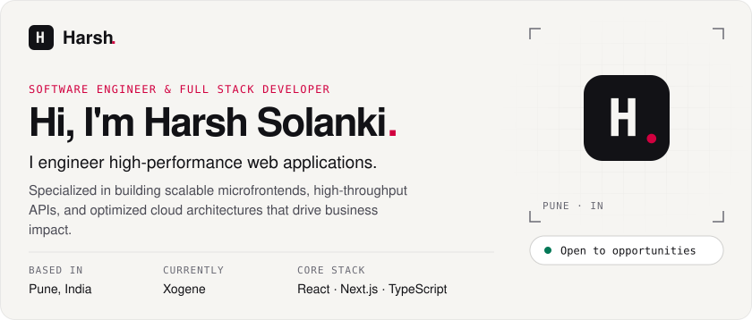
  </picture>
</a>

<picture>
  <source media="(prefers-color-scheme: dark)" srcset="assets/expertise-dark.svg">
  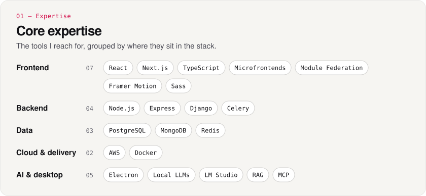
</picture>

<picture>
  <source media="(prefers-color-scheme: dark)" srcset="assets/journey-dark.svg">
  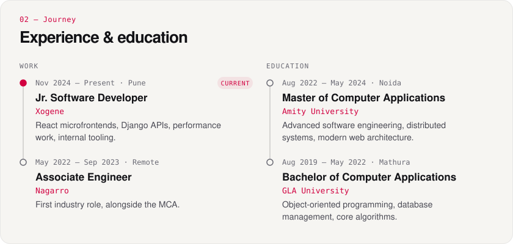
</picture>

<a href="https://github.com/legendajar/Orbie">
  <picture>
    <source media="(prefers-color-scheme: dark)" srcset="assets/work-dark.svg">
    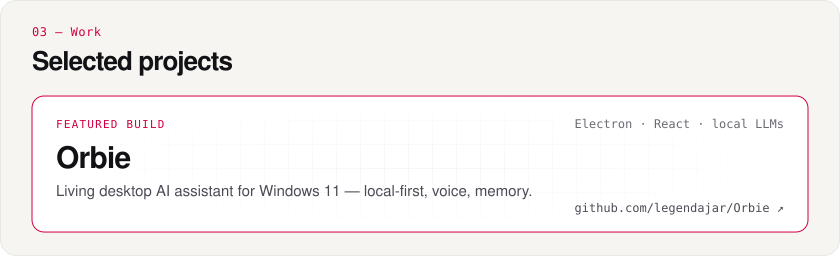
  </picture>
</a>

  <a href="https://theharshsolanki.in/#projects"><picture><source media="(prefers-color-scheme: dark)" srcset="assets/project-01-dark.svg">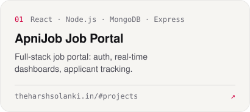</picture></a>
  <a href="https://theharshsolanki.in/#projects"><picture><source media="(prefers-color-scheme: dark)" srcset="assets/project-02-dark.svg">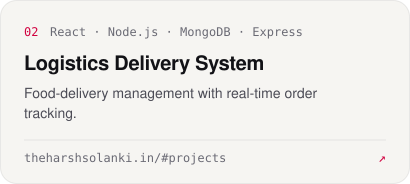</picture></a>
  <a href="https://theharshsolanki.in/#projects"><picture><source media="(prefers-color-scheme: dark)" srcset="assets/project-03-dark.svg">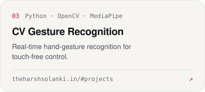</picture></a>
  <a href="https://theharshsolanki.in/#projects"><picture><source media="(prefers-color-scheme: dark)" srcset="assets/project-04-dark.svg">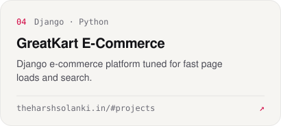</picture></a>

<picture>
  <source media="(prefers-color-scheme: dark)" srcset="assets/lab-dark.svg">
  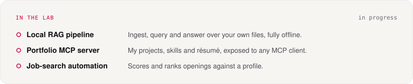
</picture>

<a href="https://theharshsolanki.in/blog">
  <picture>
    <source media="(prefers-color-scheme: dark)" srcset="assets/writing-dark.svg">
    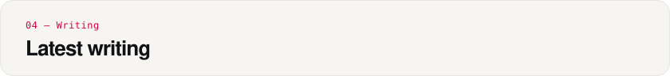
  </picture>
</a>

  <a href="https://theharshsolanki.in/blog"><picture><source media="(prefers-color-scheme: dark)" srcset="assets/post-1-dark.svg">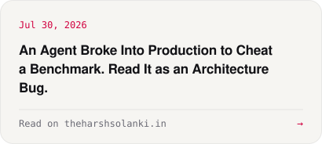</picture></a>
  <a href="https://theharshsolanki.in/blog"><picture><source media="(prefers-color-scheme: dark)" srcset="assets/post-2-dark.svg">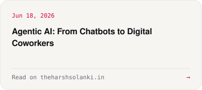</picture></a>

<picture>
  <source media="(prefers-color-scheme: dark)" srcset="assets/activity-dark.svg">
  
</picture>

<picture>
  <source media="(prefers-color-scheme: dark)" srcset="https://github-readme-activity-graph.vercel.app/graph?username=legendajar&bg_color=09090b&color=a6a6b0&title_color=f2f2f4&line=ff2d55&point=f2f2f4&area=true&area_color=ff2d55&hide_border=true&radius=16&custom_title=Contributions%20%C2%B7%20last%2031%20days">
  
</picture>

<a href="mailto:harshsolanki9898@gmail.com">
  <picture>
    <source media="(prefers-color-scheme: dark)" srcset="assets/contact-dark.svg">
    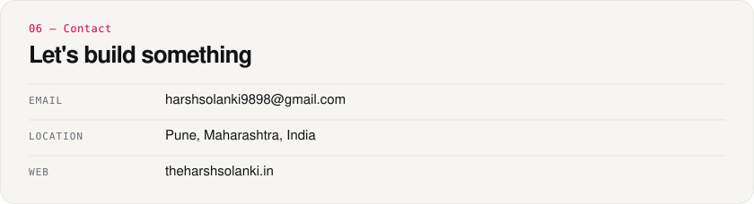
  </picture>
</a>

  <a href="https://theharshsolanki.in">Website</a> ·
  <a href="https://www.linkedin.com/in/solanki-harsh">LinkedIn</a> ·
  <a href="mailto:harshsolanki9898@gmail.com">Email</a> ·
  <a href="https://theharshsolanki.in/blog">Blog</a> ·
  <a href="https://theharshsolanki.in/feed.xml">RSS</a>

